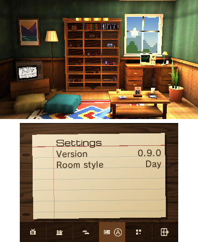
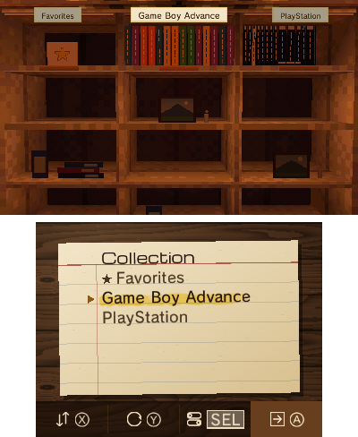
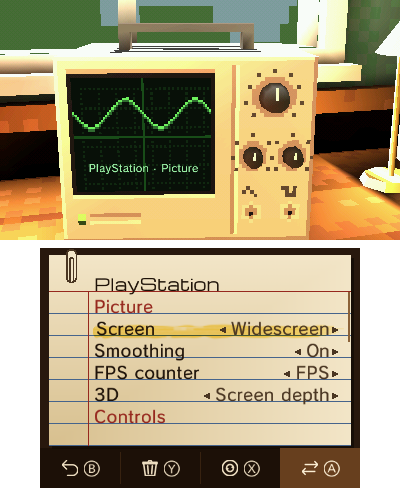
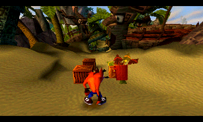
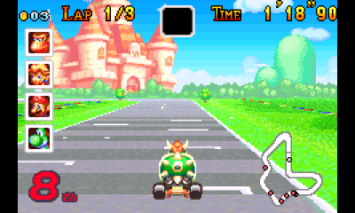
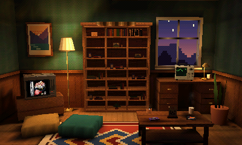
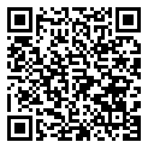

<p align="center">
  <picture>
    <source media="(prefers-color-scheme: dark)" srcset="docs/images/header-dark.png">
    
  </picture>
</p>

<p align="center"><b>PlayStation and Game Boy Advance games on the Nintendo 3DS, in one app.</b></p>

<p align="center">
  <a href="https://github.com/BreadChaser/BreadBox/releases/latest"></a>
  <a href="https://github.com/BreadChaser/BreadBox/releases"></a>
  <a href="LICENSE"></a>
  
</p>

<p align="center">
  <a href="#install">Install</a> ·
  <a href="docs/getting-started.md">Guide</a> ·
  <a href="#controls">Controls</a> ·
  <a href="#performance">Performance</a> ·
  <a href="#faq">FAQ</a> ·
  <a href="https://github.com/BreadChaser/BreadBox/issues/new/choose">Report a problem</a>
</p>

<table>
  <tr>
    <td align="center"><br><sub>The room</sub></td>
    <td align="center"><br><sub>Your Collection</sub></td>
    <td align="center"><br><sub>Settings</sub></td>
  </tr>
  <tr>
    <td align="center"><br><sub>Crash Bandicoot on Old 3DS</sub></td>
    <td align="center"><br><sub>Mario Kart: Super Circuit on Old 3DS</sub></td>
    <td align="center"><br><sub>The room at night</sub></td>
  </tr>
</table>

BreadBox plays PlayStation and Game Boy Advance games on every 3DS and 2DS. Its
main menu is a small 3D room: walk to the bookcase for your games, to the TV to
pick up where you left off, or to the oscilloscope for Settings. It finds your games on
the SD card by itself, needs no BIOS files, and keeps itself up to date over
Wi-Fi. BreadBox is the successor to [PSX3D](https://github.com/BreadChaser/PSX3D)
and brings your PSX3D saves over on first start.

All screenshots were taken on real consoles.

> [!NOTE]
> BreadBox 0.9.2 is a public beta. Most games play well, but demanding
> PlayStation games run slower on the Old 3DS, and some games have drawing
> problems. See [Performance](#performance) and [Known issues](#known-issues).

## Features

**Two systems in one app**
- PlayStation, drawn by the 3DS graphics chip, with tested settings for many games applied automatically
- Game Boy Advance, with battery saves, real-time clock games and the solar sensor in the Boktai games
- Built-in BIOS for both systems: BIOS files are optional
- Fast forward in every game, and rewind on New 3DS
- 3D: Game Boy Advance games get layered depth with the 3D slider; on New 3DS, PlayStation games can sit behind the screen or use the experimental Real 3D
- Widescreen for PlayStation games with a tested fix
- Cheats for both systems

**A room instead of a menu**
- The room is the main menu, in a Day or a Night style
- Your Collection is a bookcase with one shelf per system; take a game out to see its box
- Box art downloads by itself for both systems
- A short welcome tour on first start shows you around and finds your games

**Keeps your progress safe**
- **Continue**: your place is saved when you pause, quit or the 3DS sleeps, and shows up as a postcard in the room; PlayStation games also save it every few minutes
- Twelve postcards per game for your own save states, each with a picture of the moment
- Automatic saves and memory cards keep backups you can put back
- A save from another emulator is asked about before it is used, and the original is kept

**And more**
- Updates itself over Wi-Fi: Automatic, Ask first or Off
- Copies your memory cards, postcards, settings, cheats and BIOS files from PSX3D
- Share BreadBox with a friend: the coffee table shows a QR code for FBI

## Install

**You need** a 3DS or 2DS with [Luma3DS](https://github.com/LumaTeam/Luma3DS)
custom firmware, and your own game files.

1. Open **FBI → Remote Install → Scan QR Code** and scan this code:

   

   Or download [**BreadBox.cia**](https://github.com/BreadChaser/BreadBox/releases/latest/download/BreadBox.cia)
   and install it with FBI.
2. Copy your games to a folder on the SD card, for example `sdmc:/roms/`.
3. Start **BreadBox** from the HOME Menu. The welcome tour finds your games folder.

After that, BreadBox updates itself over Wi-Fi. A `.3dsx` for the
Homebrew Launcher is on the [release page](https://github.com/BreadChaser/BreadBox/releases/latest);
it does not update itself.

**Coming from PSX3D?** Install BreadBox next to it; your saves come over on first start. See [Moving from PSX3D](docs/moving-from-psx3d.md).

## Getting started

Put your games under one folder on the SD card, such as `sdmc:/roms/`.
Subfolders and a mix of systems are fine. BreadBox finds the folder, checks it
for new games at every start, and downloads box art by itself.

| System | Files |
|---|---|
| PlayStation | `.cue/.bin`, `.chd`, `.pbp`, `.iso`, `.img`, `.mdf`, `.m3u` |
| Game Boy Advance | `.gba`, or a `.zip` with one game inside |

No BIOS files are needed. Your saves and settings live in `sdmc:/3ds/BreadBox/`.

More in the guides: [games, BIOS, box art and your files](docs/getting-started.md) ·
[moving from PSX3D](docs/moving-from-psx3d.md) ·
[updates](docs/getting-started.md#updates)

## Controls

| Where | Button | Action |
|---|---|---|
| Room | D-pad / A / B | Walk / open / back |
| Collection | A / B | Open a shelf, take a game out, play / back |
| Collection | Y / X | Favorite / sort (hold Y on the bookcase to look for new games) |
| PlayStation | A / B / X / Y | Circle / Cross / Triangle / Square |
| PlayStation | L / R / ZL / ZR | L1 / R1 / L2 / R2 |
| PlayStation | Circle Pad / C-Stick | D-pad or left stick / right stick |
| PlayStation | Pause button on the touch screen | Pause menu |
| Game Boy Advance | A / B / L / R / START / SELECT | The same buttons |
| Game Boy Advance | D-pad or Circle Pad | D-pad |
| Game Boy Advance | X, or tap the touch screen | Pause menu |
| In a game | SELECT + R | Fast forward on / off |
| In a game | Hold SELECT + L | Rewind (New 3DS) |

Buttons can be changed per system in **Settings → Systems**, and the fast
forward and rewind shortcuts in **Settings → Customize**. The Old 3DS shows L2
and R2 on the touch screen in PlayStation games, plus a right stick in analog
games. Open Settings in the room to change things for all games, or from the
pause menu for only the game you are playing.

## Performance

Measured on a real Old 3DS with BreadBox 0.9.0, Auto frameskip, in each game's
heaviest saved scene. 100% is full speed. The New 3DS is faster and has not
been measured game by game yet.

| PlayStation | Speed | | Game Boy Advance | Speed |
|---|---:|---|---|---:|
| Symphony of the Night | 100% | | Kirby: Nightmare in Dream Land | 100% |
| Final Fantasy VII | 100% | | Pokémon Emerald | 100% |
| Crash Bandicoot 2 | 99% | | Mario Kart: Super Circuit | 100% |
| Tekken 3 | 98% | | Golden Sun | 92% |
| Crash Team Racing | 96% | | Mario Golf: Advance Tour | 80% |
| Gran Turismo 2 | 64% | | Doom | 60% |

Every measured game, the scenes and the method: [docs/performance.md](docs/performance.md).

## Known issues

- Demanding games run below full speed on the Old 3DS.
- Real 3D (New 3DS) and some PlayStation picture effects have drawing problems.
- A few Game Boy Advance games don't play: games that need the link cable, a
  motion sensor or other extra cartridge hardware, and games over 32 MB. See the
  [compatibility list](docs/compatibility.md#game-boy-advance).
- Game Boy Advance has no touch-screen buttons in this version, so the touch
  screen stays dark while you play. Tap it to pause.
- European PlayStation discs with LibCrypt protection need a matching `.sbi`
  file next to the disc image.
- With the built-in BIOS, the first Gran Turismo hangs and Mega Man Legends 2
  goes black after the intro. A real BIOS fixes Gran Turismo.

Found something else? [Open an issue](https://github.com/BreadChaser/BreadBox/issues/new/choose)
and attach `log.txt` if you can.

## Planned features

- **Nintendo 64.** The next system for BreadBox. Early work has started; it
  will run on the New 3DS only.
- **Play together.** Play with a friend's 3DS over local wireless. The cushions
  in the room are already waiting for it.
- **Game Boy Advance touch controls.** The on-screen buttons are off in 0.9 and
  will come back redesigned.
- **More tuned games.** Recommended settings for more PlayStation and Game Boy
  Advance games, on both the Old and the New 3DS.
- **Motion sensor games.** Support for cartridges with a motion sensor, such as
  the gyro sensor in WarioWare: Twisted!.

## FAQ

**Old 3DS or New 3DS?**
Both are supported. The New 3DS has a faster processor, adds rewind for both
systems, and adds 3D for PlayStation games. The Old 3DS runs most Game Boy
Advance games and many PlayStation games at full speed; demanding PlayStation
3D games are slower there. See [Performance](#performance).

**Do I need a BIOS?**
No. Both systems have one built in. A real one is used automatically if you add it.

**Can I keep PSX3D?**
Yes. BreadBox is a separate app with its own folder. It copies PSX3D's saves
once and never changes them.

**Why is it slow in Azahar or without Luma3DS?**
BreadBox's fast mode needs Luma3DS on a real console. In a PC emulator it still
starts, but much slower, and the room says so.

**Can I turn off automatic updates?**
Yes: **Settings → Updates → Off**. You can still use **Check now**.

## Building from source

You need devkitPro (devkitARM, libctru, citro2d, citro3d), makerom and
bannertool, at the versions pinned in the repository. Full steps are in
[docs/building.md](docs/building.md).

```bash
git clone https://github.com/BreadChaser/BreadBox.git
cd BreadBox
make            # build/3ds/BreadBox.3dsx
make cia        # installable CIA (needs bannertool and a fixed makerom)
make host-tests
```

Developer documentation is indexed in [docs/dev/](docs/dev/README.md).

## Credits and license

- **BreadChaser**: BreadBox and PSX3D
- [PCSX-ReARMed](https://github.com/libretro/pcsx_rearmed): notaz, Exophase and
  libretro contributors; based on PCSX, PCSX-Reloaded and P.E.Op.S.
- [gpSP](https://github.com/libretro/gpsp): Exophase and the libretro gpSP
  contributors; open GBA BIOS by Normmatt and the VBA/VBA-M team
- The PCSX-ReARMed 3DS port authors; devkitPro (libctru, citro2d, citro3d);
  [DSP1](https://github.com/zoogie/DSP1) by zoogie
- Room hands: "Hand (low poly)" by scribbletoad (CC BY 4.0); menu sounds by
  Joseph Sardin, Kenney and OwlishMedia (CC0)
- Icons by [Dreamstale](https://www.flaticon.com/authors/dreamstale) from
  [Flaticon](https://www.flaticon.com) (Flaticon license, not GPL);
  [artwork, fonts and cheat sources](tools/art/CREDITS.md)

The full list is in [CREDITS](CREDITS). The PlayStation emulator lives in
`core/`; Game Boy Advance has its own emulator and renderer in `gba-core/`.

BreadBox is licensed under the [GPL-2.0-or-later](LICENSE). Keep LICENSE,
CREDITS and the core and dependency notices when you share sources or binaries.
It is not affiliated with Sony, Nintendo or libretro.
